# UX Prototype

## 1. Format and purpose

The prototype is a pair of clickable HTML files with test data. It shows how users interact with WorkTrack
in the key scenarios. It is not connected to the backend: all data is simulated.

| Prototype | File | Actor |
|---|---|---|
| Employee mobile app (phone frame, GPS scenario controls) | [mobile.html](prototype/mobile.html) | Employee |
| Administrator web panel | [web.html](prototype/web.html) | Administrator |

**How to open:** download or clone the repository and open the file in Chrome or Edge. No installation is needed.
Login for both prototypes: any email, password `demo`. In the mobile prototype the panel next to the phone selects
the GPS scenario for the next check-in (accepted, poor accuracy, outside zone, GPS off).

**Design decisions.** Light Material 3 style, one primary colour, status colours used only for mark statuses
(ACCEPTED / NEEDS_REVIEW / REJECTED). Status is always shown with an icon and text, not by colour only.
The main action of each app is reachable in one or two taps or clicks.

The prototype is kept in HTML to keep it versioned in the repository and reproducible; screenshots are in
`docs/prototype/screenshots/`.

## 2. Key scenarios

| # | Scenario | Actor | Steps | Use cases | Requirements | Screens |
|---|---|---|---|---|---|---|
| S1 | Check in inside the workplace | Employee | Log in; tap "Check in"; see result | UC-01, UC-04 | FR-01, FR-12, FR-14, FR-18 | m01, m02, m03 |
| S2 | Uncertain GPS is reviewed, not punished | Employee, Administrator | Check in with poor accuracy; mark gets NEEDS_REVIEW; administrator approves in Dashboard or Attendance | UC-04, UC-15 | FR-15, FR-20 | m04, w02, w03 |
| S3 | Check in outside the zone | Employee | Tap "Check in"; see distance and allowed radius; try again or request remote work | UC-04 | FR-14, FR-19 | m05 |
| S4 | GPS unavailable | Employee | Tap "Check in" with location off; see error; action is not lost | UC-04 | FR-19 | m06 |
| S5 | Work session, check out and history | Employee | Work timer; check out; open history of a day | UC-05, UC-06 | FR-13, FR-22, FR-26 | m07, m09 |
| S6 | Presence check (extension) | Employee, Administrator | Confirm presence in the dialog; administrator sees check results in the day details | UC-08, UC-18, UC-19 | FR-33, FR-35, FR-36, FR-37 | m08 |
| S7 | Request and decision | Employee, Administrator | Employee submits a request; administrator approves it in Requests | UC-07, UC-16 | FR-30, FR-31 | m10, w07 |
| S8 | Create a workplace with a geofence | Administrator | Open Workplaces; enter coordinates; set radius with the slider | UC-12 | FR-06 | w05 |
| S9 | Add an employee and assign a schedule | Administrator | Employees: add; Schedules: assign | UC-11, UC-13 | FR-04, FR-09, FR-10 | w04, w06 |
| S10 | Review statistics | Administrator | Reports: day, week, month, presence results | UC-17 | FR-28 | w08 |
| S11 | Change organization rules | Administrator | Settings: grace period, GPS threshold, check interval | UC-10 | FR-25, FR-36 | w09 |

## 3. Screens

### 3.1 Employee mobile app

| Screen | Screenshot | Use case |
|---|---|---|
| Login | 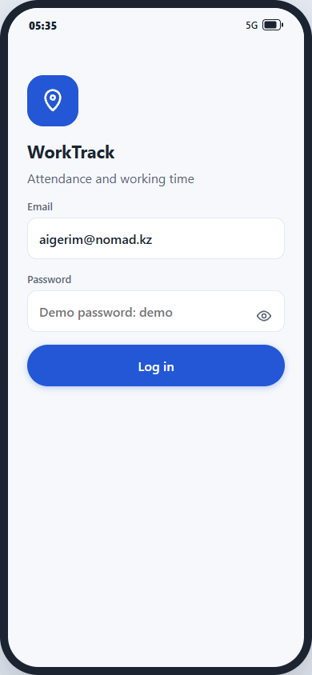 | UC-01 |
| Home, not checked in | 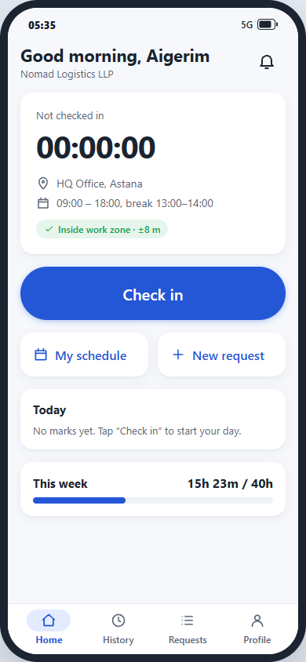 | UC-03, UC-04 |
| Check-in accepted | 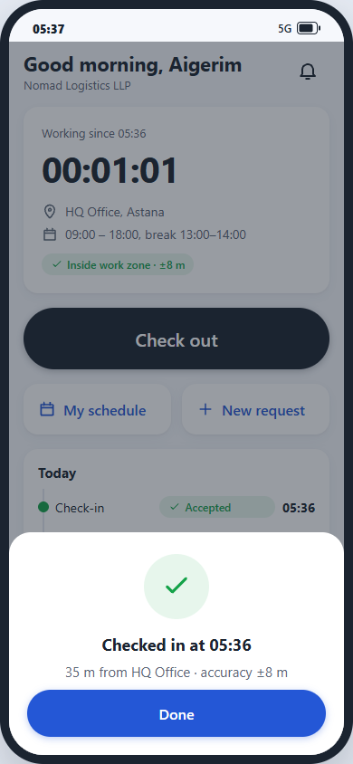 | UC-04 |
| Check-in needs review | 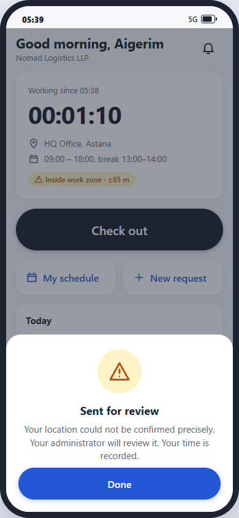 | UC-04 |
| Check-in rejected (outside zone) | 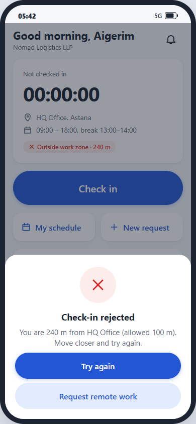 | UC-04 |
| GPS error | 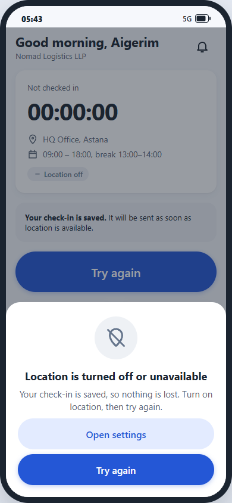 | UC-04 |
| Home, work in progress | 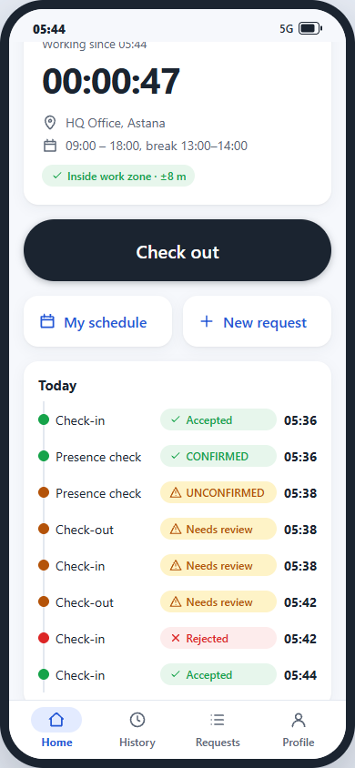 | UC-05 |
| Presence check dialog | 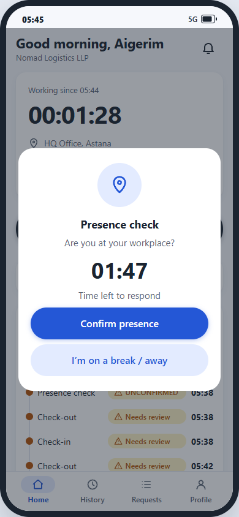 | UC-08 |
| History, day details | 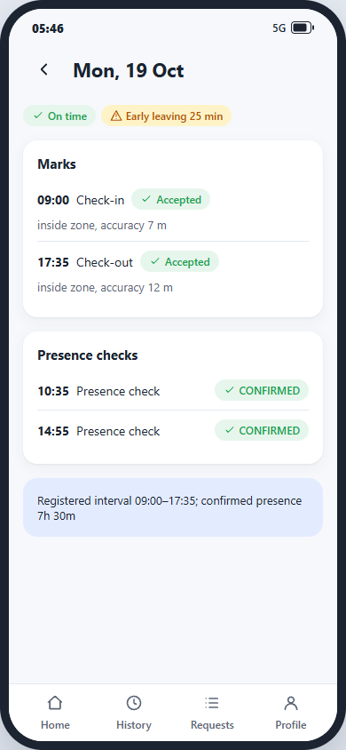 | UC-06 |
| New request | 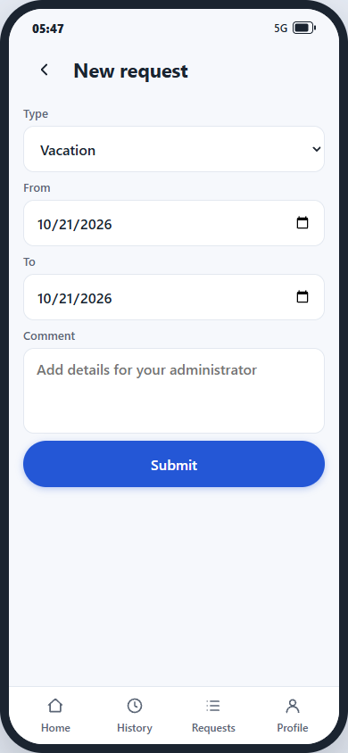 | UC-07 |
| Schedule | 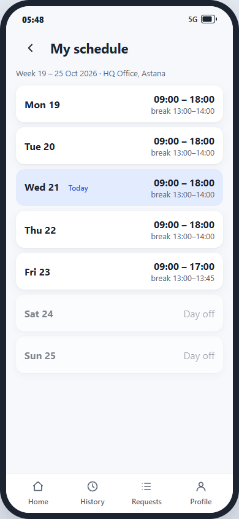 | UC-03 |
| Profile | 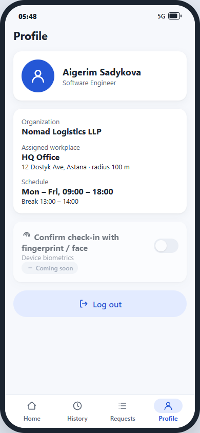 | UC-02 |

### 3.2 Administrator web panel

| Screen | Screenshot | Use case |
|---|---|---|
| Login | 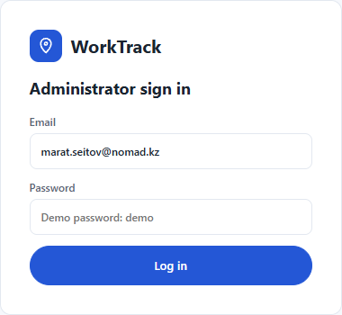 | UC-01 |
| Dashboard | 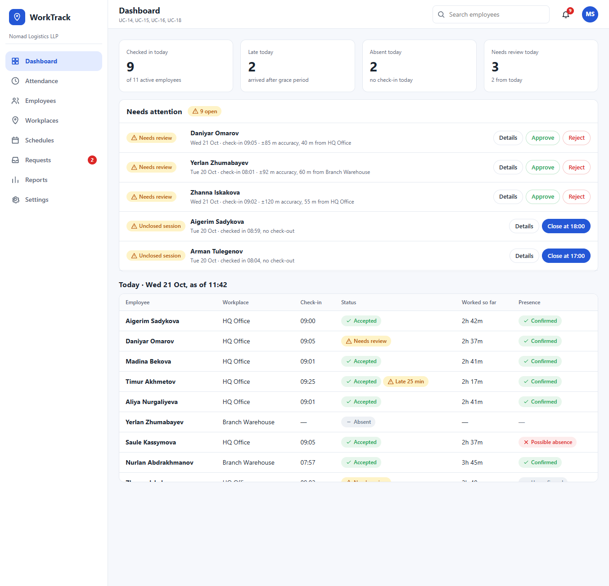 | UC-14, UC-15, UC-16, UC-18 |
| Attendance with details drawer | 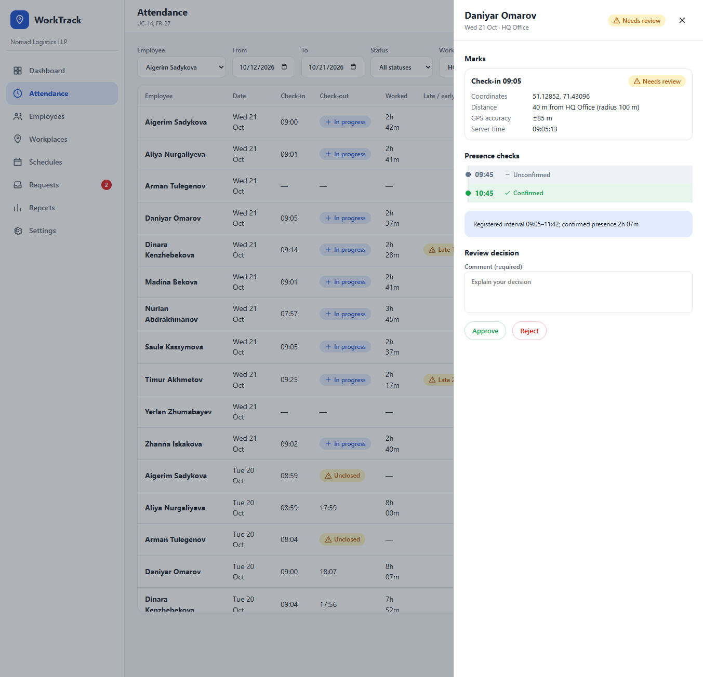 | UC-14, UC-15 |
| Add employee | 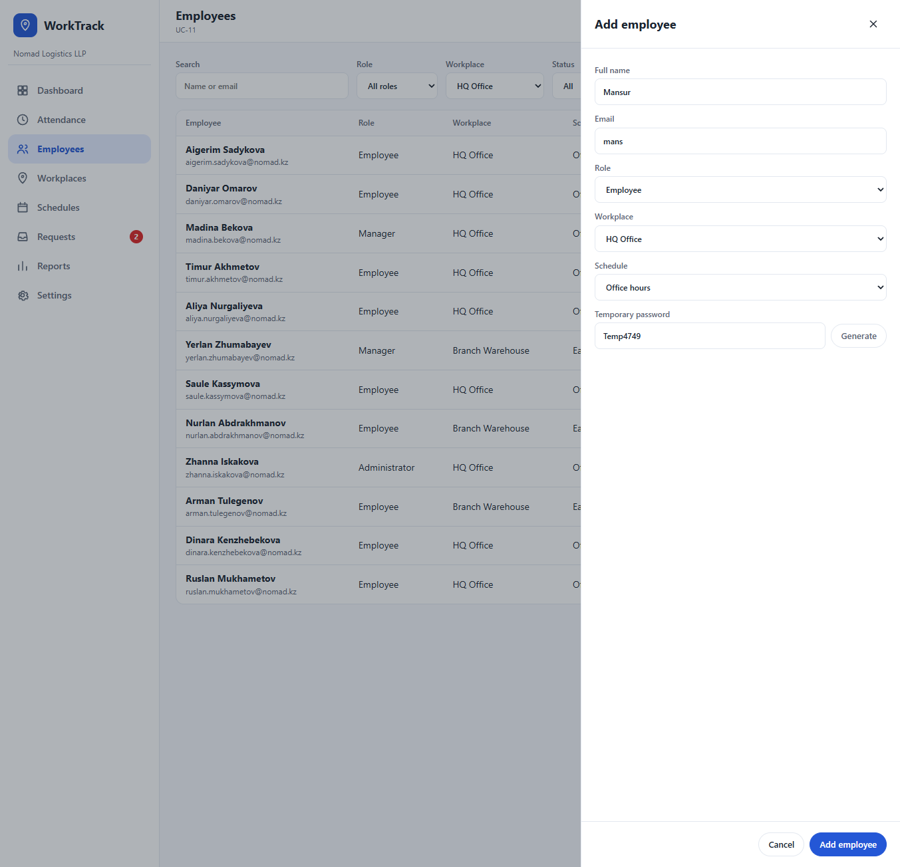 | UC-11 |
| Workplace with geofence radius | 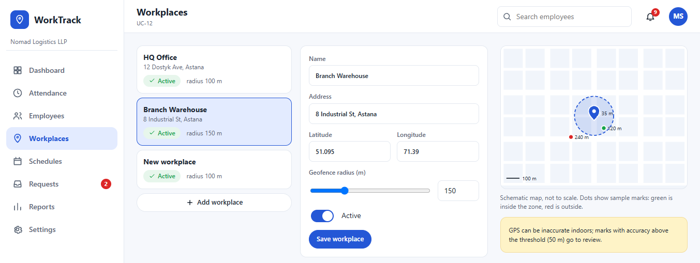 | UC-12 |
| Schedules | 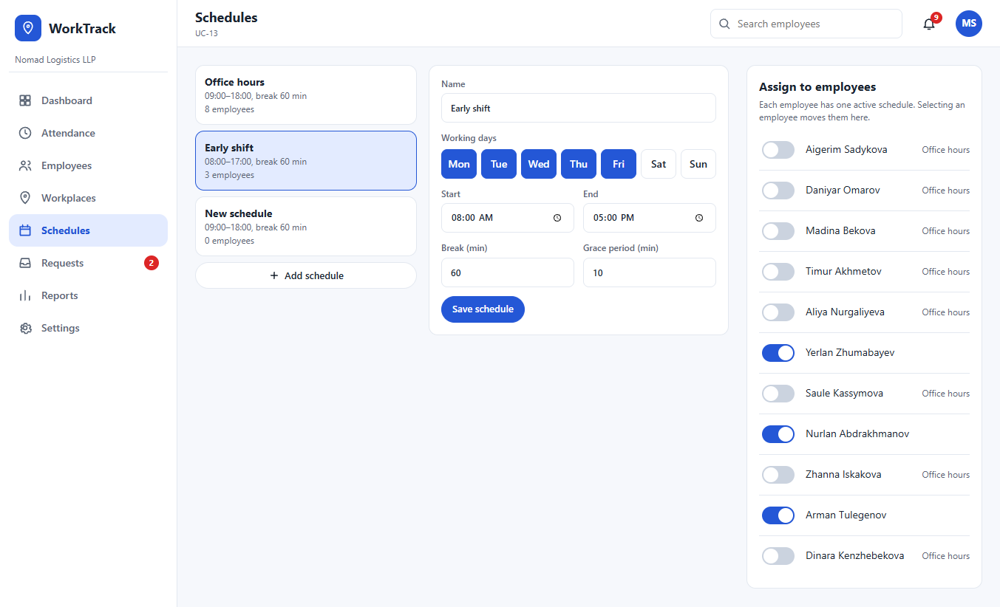 | UC-13 |
| Requests | 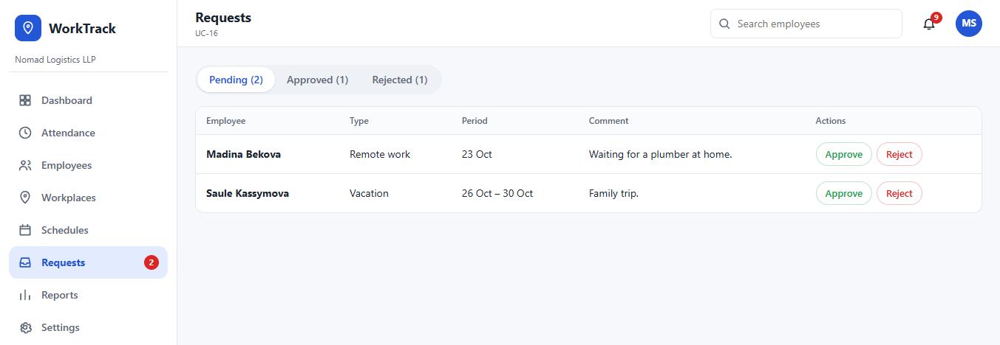 | UC-16 |
| Reports | 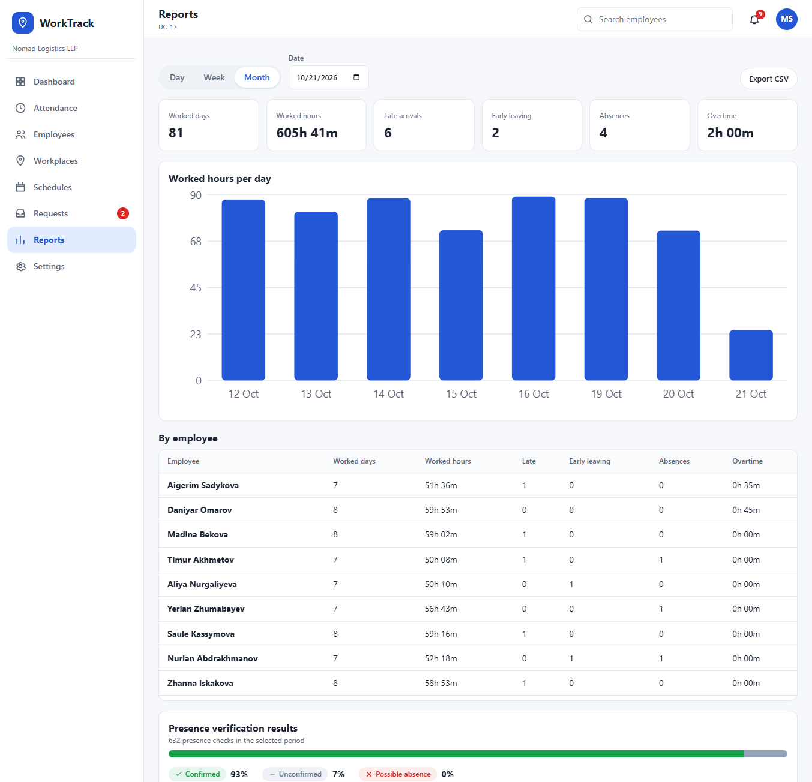 | UC-17 |
| Settings | 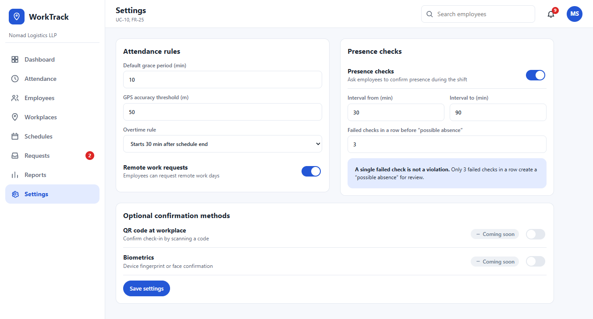 | UC-10 |

## 4. Interaction effort

| Frequent action | Actor | Taps or clicks from the start screen | Requirement |
|---|---|---|---|
| Check in or out | Employee | 1 (from Home, after login) | NFR-10 (at most 3) |
| View schedule | Employee | 1 (quick link) | FR-11 |
| Submit a request | Employee | 2 (quick link or Requests tab, then form) | FR-30 |
| Approve or reject a flagged mark | Administrator | 1 (inline in Dashboard) | FR-20 |
| Approve or reject a request | Administrator | 1 (inline in Dashboard) | FR-31 |
| See who is late today | Administrator | 1 (KPI card opens filtered Attendance) | FR-27 |

The values are counted on the prototype by the author. They will be checked on the real application (see
`09-verification-plan.md`).

## 5. Status of evidence and limitations

- The prototype is based on the requirements ([06-requirements.md](06-requirements.md)) and is **not validated
  with users**. The interface decisions remain assumptions; usability is planned to be checked on the working
  application (see EXP-6 in [09-verification-plan.md](09-verification-plan.md)).
- Test data is fictional. No backend, no real location, no real notifications.
- Not covered: Remote Work, QR code, biometrics, task module (shown only as "Coming soon" settings), and the
  notification list.
- The final Flutter and React interface may differ in layout; changes will be recorded in the repository.